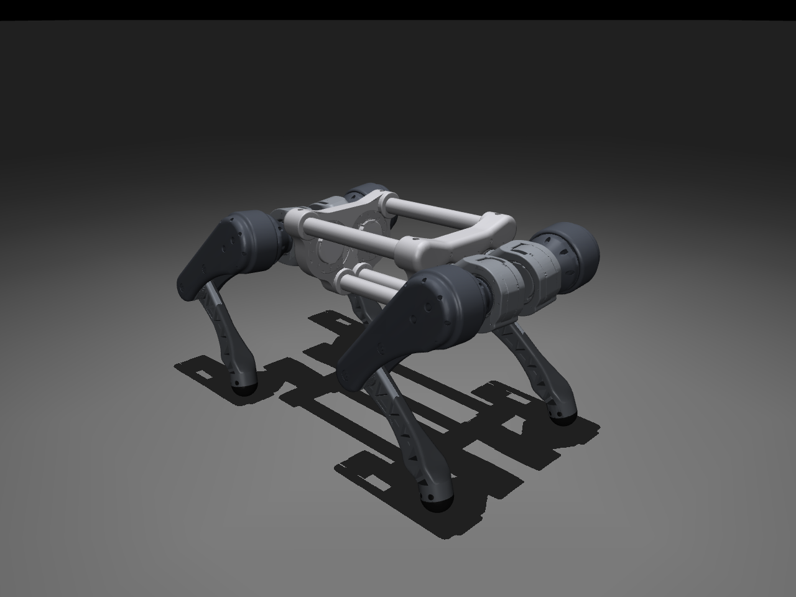

# HYPER v1 사족보행 URDF

Inventor 조립품 `trunk-hip-thigh-calf-foot.iam`(왼쪽 앞·뒤 다리)에서 질량 특성과 관절 위치를 추출해 만든 URDF입니다. 오른쪽 다리는 왼쪽 다리를 몸체 좌우 대칭면에 대해 미러링했습니다. 좌표 규약, 링크·조인트 이름, 관절 위치 한계는 Unitree Go2(Isaac Lab용 USD)를 따르고, 토크·속도는 실제 모터 Unitree GO-M8010-6 값입니다.

- 링크 17개, 회전 관절 12개, 총 질량 **12.329 kg**
- MuJoCo 3.17.0에서 로드·선 자세 검증 완료 (18/18)
- Isaac Sim 5.1용 USD(`usd/hyper.usd`)와 검증 31/31: [`isaacsim/README.md`](isaacsim/README.md)
- `isaaclab/hyper_cfg.py`는 생성만 했고 실행해 보지 않았습니다(Isaac Lab 학습 환경은 별도로 정리 중).



## 폴더 구성

| 경로 | 내용 |
| --- | --- |
| `urdf/hyper.urdf` | 로봇 모델 |
| `meshes/*.stl` | 화면용 메시. `trunk/hip/thigh/calf_foot.stl`은 제공된 STL 원본 그대로(`calf-foot.stl`은 USD 이름 규칙 때문에 이름만 `calf_foot.stl`로 바꿈), `*_mirror.stl`은 오른쪽 다리용 y 반전본 |
| `meshes/collision/*.stl` | 충돌용 메시. 같은 CAD를 부품 인스턴스별로 내보낸 것 (아래 '충돌' 참고) |
| `mujoco/hyper_scene.xml`, `mujoco/view.py` | MuJoCo 장면(바닥, 자유 몸체, 모터, 키프레임)과 뷰어 |
| `usd/`, `isaacsim/` | Isaac Sim 5.1용 USD(`usd/hyper.usd`, 장면 `usd/hyper_scene.usda`)와 변환·검증·뷰어 스크립트 |
| `isaaclab/hyper_cfg.py` | unitree_rl_lab의 `UNITREE_GO2_CFG`를 옮긴 Isaac Lab 설정 |
| `properties/hyper_properties.json` | 링크별 물성치, CAD↔링크 좌표 변환, 부품 재질, 검사 결과 전체 |
| `config/go2_reference.json` | Go2 USD와 설정 코드에서 추출한 값과 출처(파일 해시 포함) |
| `validation/` | 충돌 근사와 실제 CAD 간섭 비교 결과 |

## 실행

```powershell
python -m pip install mujoco==3.17.0
python mujoco\view.py            # Go2 PD 제어로 선 자세 유지
python -m mujoco.viewer --mjcf=mujoco\hyper_scene.xml   # 제어 없이 보기 (넘어짐)
```

## 좌표계

Go2(`go2_description` / `go2.usd`)와 같은 규약입니다.

- base: x 전방, y 왼쪽, z 위. 원점은 trunk 좌우 대칭면 위, hip(외전) 축 높이, 앞뒤 hip 관절의 가운데입니다.
- 관절 축: `*_hip_joint` x, `*_thigh_joint` y, `*_calf_joint` y. `*_foot_joint`는 고정이며 발 공의 중심입니다.
- 모든 링크 좌표계는 관절각 0에서 base와 평행하고, 이때 다리는 수직으로 내려옵니다(무릎 축이 허벅지 축 바로 아래, 발 중심이 무릎 축 바로 아래).
- 오른쪽 다리는 xz 평면 미러입니다. Go2처럼 축 방향은 그대로 두므로 hip 각도만 부호가 반대가 됩니다.

CAD 조립품(`trunk-hip-thigh-calf-foot.iam`) 좌표와의 관계: base x = CAD −Y, y = CAD +X, z = CAD +Z, 원점 = CAD (-41.224, 89.608, -146.969) mm. 링크별 변환(4×4 회전, 원점, rpy)은 `properties/hyper_properties.json`의 `link_frame_in_cad_assembly`와 `mesh_frame_in_link`(STL 좌표 → 링크 좌표)에 있습니다.

## 링크 물성치

질량 kg, 무게중심 m(링크 좌표), 관성 kg·m²(무게중심 기준, 링크 축). 오른쪽 링크는 왼쪽과 같고 무게중심 y, Ixy, Iyz의 부호만 반대입니다.

| 링크 | 질량 | 무게중심 x, y, z | Ixx | Iyy | Izz | Ixy | Ixz | Iyz |
| --- | --- | --- | --- | --- | --- | --- | --- | --- |
| base | 2.3043 | 0.00000, 0.00000, -0.00064 | 8.5835e-03 | 4.5188e-02 | 5.0134e-02 | -2.5093e-05 | 0 | 0 |
| FL_hip | 0.6709 | -0.00480, 0.00106, -0.00072 | 5.1581e-04 | 9.3521e-04 | 5.9955e-04 | -8.1513e-06 | 4.7232e-06 | 1.2933e-06 |
| FL_thigh | 1.0800 | -0.00158, -0.00580, -0.02810 | 4.7745e-03 | 4.7537e-03 | 1.2705e-03 | 2.0472e-05 | -1.3246e-04 | 4.1079e-04 |
| FL_calf | 0.1686 | 0.00778, 0.00257, -0.09006 | 1.0566e-03 | 1.0748e-03 | 5.7826e-05 | 3.3698e-06 | 6.2933e-05 | -3.9024e-05 |
| FL_foot | 0.5866 | -0.00130, 0.00000, -0.00231 | 1.3087e-04 | 1.4854e-04 | 1.2834e-04 | -7.7337e-12 | -2.0844e-06 | 4.3815e-12 |
| RL_hip | 0.6709 | 0.00480, 0.00106, 0.00072 | 5.1581e-04 | 9.3521e-04 | 5.9955e-04 | 8.1513e-06 | 4.7232e-06 | -1.2933e-06 |
| RL_thigh | 1.0800 | -0.00158, -0.00580, -0.02810 | 4.7745e-03 | 4.7537e-03 | 1.2705e-03 | 2.0472e-05 | -1.3246e-04 | 4.1079e-04 |
| RL_calf | 0.1686 | 0.00778, 0.00257, -0.09006 | 1.0566e-03 | 1.0748e-03 | 5.7826e-05 | 3.3698e-06 | 6.2933e-05 | -3.9024e-05 |
| RL_foot | 0.5866 | -0.00130, 0.00000, -0.00231 | 1.3087e-04 | 1.4854e-04 | 1.2834e-04 | -7.7337e-12 | -2.0844e-06 | 4.3815e-12 |

- 각 링크는 같은 이름의 Inventor 서브 조립품 전체의 질량 특성입니다. calf와 foot은 `calf-foot.iam`에서 발 공 부품(`v1_G1_발(고무공)`)을 foot으로 분리하고 나머지를 calf로 두었습니다.
- 관성곱 부호는 텐서 성분(Ixy = −∫xy dm)입니다. Inventor가 같은 규약임을 L자 시험 부품으로 확인했습니다.

## 관절

| 관절 | 부모 기준 위치 m | 축 | 하한 | 상한 | effort N·m | velocity rad/s | CAD 자세 각도 |
| --- | --- | --- | --- | --- | --- | --- | --- |
| FL_hip_joint | 0.2283, 0.0475, 0.0000 | 1 0 0 | -1.0472 | 1.0472 | 23.7 | 30 | 0.0000 |
| FL_thigh_joint | 0.0000, 0.0958, 0.0000 | 0 1 0 | -1.5708 | 3.4907 | 23.7 | 30 | 0.9442 |
| FL_calf_joint | 0.0000, 0.0000, -0.2000 | 0 1 0 | -2.7227 | -0.83776 | 23.7 | 30 | -1.9148 |
| FL_foot_joint (고정) | 0.0000, 0.0000, -0.2165 | | | | | | |
| FR_hip_joint | 0.2283, -0.0475, 0.0000 | 1 0 0 | -1.0472 | 1.0472 | 23.7 | 30 | 0.0000 |
| FR_thigh_joint | 0.0000, -0.0958, 0.0000 | 0 1 0 | -1.5708 | 3.4907 | 23.7 | 30 | 0.9442 |
| FR_calf_joint | 0.0000, 0.0000, -0.2000 | 0 1 0 | -2.7227 | -0.83776 | 23.7 | 30 | -1.9148 |
| FR_foot_joint (고정) | 0.0000, 0.0000, -0.2165 | | | | | | |
| RL_hip_joint | -0.2283, 0.0475, 0.0000 | 1 0 0 | -1.0472 | 1.0472 | 23.7 | 30 | 0.0712 |
| RL_thigh_joint | 0.0000, 0.0958, 0.0000 | 0 1 0 | -0.5236 | 4.5379 | 23.7 | 30 | 0.8206 |
| RL_calf_joint | 0.0000, 0.0000, -0.2000 | 0 1 0 | -2.7227 | -0.83776 | 23.7 | 30 | -1.7686 |
| RL_foot_joint (고정) | 0.0000, 0.0000, -0.2165 | | | | | | |
| RR_hip_joint | -0.2283, -0.0475, 0.0000 | 1 0 0 | -1.0472 | 1.0472 | 23.7 | 30 | -0.0712 |
| RR_thigh_joint | 0.0000, -0.0958, 0.0000 | 0 1 0 | -0.5236 | 4.5379 | 23.7 | 30 | 0.8206 |
| RR_calf_joint | 0.0000, 0.0000, -0.2000 | 0 1 0 | -2.7227 | -0.83776 | 23.7 | 30 | -1.7686 |
| RR_foot_joint (고정) | 0.0000, 0.0000, -0.2165 | | | | | | |

허벅지 길이 0.2000 m, 종아리(무릎 축→발 중심) 0.2165 m, 발 반지름 0.0250 m. Go2는 각각 0.213, 0.213, 0.022 m입니다.

## 모터

모든 관절에 Unitree GO-M8010-6을 씁니다(감속비 6.33, 출력축 최대 23.7 N·m, 최대 30 rad/s, RS-485). 몸체에 hip 모터 4개, hip 링크에 thigh 모터, thigh 링크에 calf 모터가 있고, calf 모터는 벨트 1:1로 무릎 종동풀리를 돌립니다. 그래서 calf 관절각은 calf 모터 출력각과 같은 꼴(방향·영점만 다름)이고 thigh 관절과 섞이지 않으며, 토크·속도 한계도 다른 관절과 같습니다. URDF·MuJoCo·USD의 effort·velocity는 모두 23.7 N·m, 30 rad/s입니다.

## Go2에서 가져온 값

- 관절 위치 한계: `Go2/usd/configuration/go2_description_physics.usd` (https://huggingface.co/datasets/unitreerobotics/unitree_model). USD의 float32 값을 유효숫자 6자리로 옮겼습니다(예: 60.0001° → 1.0472 rad).
- Isaac Lab 설정: https://github.com/unitreerobotics/unitree_rl_lab @ `4960b84`의 `UNITREE_GO2_CFG` — 초기 자세(pos 0.4 m, hip ±0.1, 앞 thigh 0.8, 뒤 thigh 1.0, calf −1.5), GO2HV 액추에이터(stiffness 25, damping 0.5, friction 0.01, 토크-속도 곡선 X1 13.5, X2 30, Y1 20.2, Y2 23.4), soft_joint_pos_limit_factor 0.9, self collision 사용. 이 파일은 아직 Go2HV 액추에이터 값을 그대로 쓰므로 GO-M8010-6 값과 다릅니다.
- USD에 joint friction, armature는 없습니다. Go2의 rotor 링크(모터 회전자 질량)는 넣지 않았습니다. HYPER는 모터 질량이 각 서브 조립품에 이미 들어 있습니다.
- MuJoCo의 `view.py`는 같은 PD(25, 0.5)에 Isaac Lab `DCMotor` 토크-속도 제한(GO-M8010-6: 정지 23.7 N·m, 무부하 30 rad/s)을 Python으로 구현합니다.

## 충돌

- 모든 링크에 충돌 형상이 있고, 서로 다른 링크끼리 충돌합니다. MuJoCo와 Isaac Lab은 부모-자식(바로 붙은 두 링크) 사이 충돌을 계산하지 않으므로, 그 사이는 관절 한계가 막습니다.
- 시뮬레이터는 메시를 볼록 껍질로 충돌시킵니다. 링크 메시 하나를 통째로 쓰면 부품 사이 빈 공간까지 막혀서(앞 허벅지가 서 있기만 해도 몸체에 3.5 mm 파고듦) CAD를 부품 인스턴스별로 내보내 부품마다 충돌 메시를 두었습니다. 발 공은 반지름 25 mm 구로 처리합니다.

실제 CAD 간섭(Inventor)과 MuJoCo 볼록 껍질 접촉 비교 (나머지 관절은 초기 자세):

| 다리 | 움직인 관절 | 각도 rad | CAD 간섭 | MuJoCo 접촉 |
| --- | --- | --- | --- | --- |
| FL | thigh | 1.25 | 없음 | 없음 |
| FL | thigh | 1.3 | 없음 | 없음 |
| FL | thigh | 1.35 | 없음 | 있음 |
| FL | thigh | 1.4 | 없음 | 있음 |
| FL | thigh | 1.45 | 있음 | 있음 |
| FL | thigh | 1.6 | 있음 | 있음 |
| FL | thigh | 2.0 | 있음 | 있음 |
| FL | thigh | 2.6 | 없음 | 있음 |
| FL | thigh | 2.65 | 없음 | 있음 |
| FL | thigh | 2.7 | 없음 | 있음 |
| FL | thigh | 2.8 | 없음 | 없음 |
| FL | hip | -1.0472 | 있음 | 있음 |
| FL | hip | -0.95 | 없음 | 없음 |
| FL | hip | -0.85 | 없음 | 없음 |
| FL | hip | 0.85 | 있음 | 있음 |
| FL | hip | 0.95 | 있음 | 있음 |
| FL | hip | 1.0472 | 있음 | 있음 |
| RL | thigh | 3.4 | 없음 | 없음 |
| RL | thigh | 3.5 | 없음 | 없음 |
| RL | thigh | 3.55 | 없음 | 없음 |
| RL | thigh | 3.6 | 없음 | 있음 |
| RL | thigh | 3.7 | 있음 | 있음 |
| RL | thigh | 4.0 | 있음 | 있음 |
| RL | thigh | 4.5379 | 있음 | 있음 |

볼록 껍질은 실제보다 약 0.05~0.1 rad 넓은 범위에서 접촉합니다(보수적). 접촉이 생기는 관절과 방향은 실제 CAD와 같습니다.

## 확인이 필요한 점

- **무릎 하한**: Go2 하한 -2.7227 rad까지 접으면 이 CAD에서는 -2.6529 rad부터 윗링크와 lowleg이 겹칩니다(4.0° 차이). 부모-자식 사이라 시뮬레이터가 막지 않습니다. Isaac Lab의 soft limit(0.9)을 쓰면 하한이 -2.6285 rad가 되어 겹치기 전입니다.
- **hip 외전**: 바깥쪽으로 약 0.85 rad 벌리면 허벅지가 몸체 하우징에 실제로 닿습니다(CAD 간섭으로 확인). Go2 한계 ±1.047 rad보다 충돌이 먼저 막습니다.
- **허벅지 뒤로 젖힘**: 앞다리 약 1.40 rad, 뒷다리 약 3.6 rad에서 몸체와 닿습니다.
- **발 공 질량**: 0.5866 kg(재정의 값, 밀도로 환산 12.0 g/cm³). 고무라면 10배 큰 값일 수 있어 확인이 필요합니다. 네 발 합계가 전체 질량의 약 19%입니다.
- **질량 재정의가 없는 부품**(재질 기본 밀도 1.0 g/cm³ 그대로): 숄더M8-L45, 스페이서-L25, 스페이서-L35, 파이프.
- 추출 시점에 Inventor에서 저장되지 않은 변경이 있던 문서: thigh.iam, 숄더M8-L45.ipt. 메모리 상태 값을 썼습니다.
- CAD 자세에서 무릎 부품끼리 이미 49 mm³ 겹칩니다(스페이서-L35와 종동풀리, 윗링크와 lowleg).
- ~~무릎 감속비~~: thigh에 달린 GO-M8010-6이 벨트 1:1로 구동합니다(2026-11-10 확인). effort·velocity를 Go2 calf 값(45.43 N·m, 15.7 rad/s)에서 23.7 N·m, 30 rad/s로 바꿨습니다. `mujoco/check_result.json`은 바꾸기 전 값으로 만든 것이지만, 선 자세 최대 토크가 11.7 N·m라 결과는 같습니다(다시 돌려 0.2969 m, 11.68 N·m 확인).

## 생성 방법

Windows의 `inventor_automation` 프로젝트(`src/robot_export.py`, `src/urdf_builder.py`, `src/mujoco_check.py`)가 실행 중인 Inventor에서 조립품을 읽기 전용으로 읽어 만들었습니다. 사용자 문서는 저장·수정하지 않았습니다.

