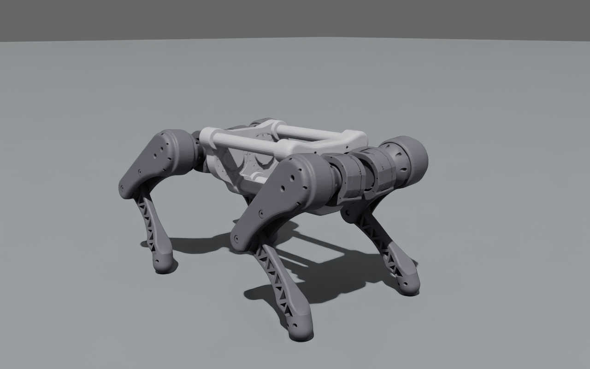

# Isaac Sim용 USD

`urdf/hyper.urdf`를 Isaac Sim 5.1 / Isaac Lab 2.3에서 바로 여는 USD로 바꾸고 검증한 결과입니다. 원본 `urdf/`, `meshes/`, `mujoco/`는 바꾸지 않았습니다.



| 파일 | 내용 |
| --- | --- |
| `usd/hyper.usd` (+ `usd/configuration/*.usd`, `hyper_base.usd`는 Git LFS) | 로봇 asset. Isaac Sim URDF Importer 구조(base / physics / robot / sensor 레이어, Physics variant = PhysX) |
| `usd/hyper_scene.usda` | 바닥(마찰 1.0), 조명, 200 Hz physics scene, Isaac Lab 초기 자세(높이 0.4 m)로 서 있는 HYPER. `./hyper.usd`를 참조 |
| `isaacsim/convert_urdf.py` | URDF → USD 변환 (Isaac Lab `UrdfConverter`) |
| `isaacsim/make_scene.py` | `hyper_scene.usda` 생성 |
| `isaacsim/check_usd.py` → `check_result.json` | 정적·물리 검증 31항목 |
| `isaacsim/view.py` | GUI로 장면을 열고 재생 |
| `isaacsim/snapshot.py` | 헤드리스 RTX 렌더 → `images/standing_iso.png` |

## 실행

```bash
source ~/so101_sim_ws/scripts/activate_sim.sh     # Isaac Sim 5.1 + Isaac Lab 2.3 env, RTX 4060
python isaacsim/view.py                           # GUI에서 바로 재생 (창을 닫으면 종료)
# 또는 Isaac Sim > File > Open > usd/hyper_scene.usda > Play
python isaacsim/convert_urdf.py && python isaacsim/make_scene.py && python isaacsim/check_usd.py   # 다시 만들기
```

Isaac Lab에서는 `sim_utils.UsdFileCfg(usd_path=".../usd/hyper.usd")`로 spawn할 수 있습니다. 관절 drive는 PD 25 / 0.5(GO2HV 값)로 들어 있으며, Isaac Lab actuator 설정이 이 값을 덮어씁니다.

## Isaac Sim URDF Importer에서 생기던 문제

1. **메시 이름 `calf-foot` (해결: `calf_foot`로 바꿈)**: Importer(2.4.30)가 visual prim 이름을 메시 파일 이름으로 짓는데, USD prim 이름에는 영문·숫자·`_`만 쓸 수 있습니다. 예전 `calf-foot.stl`은 `/visuals/FL_calf/calf-foot`에서 `Used null prim` 오류로 import가 멈췄고, Isaac Lab `UrdfConverter`는 이 오류를 넘긴 채 빈 USD(492바이트)를 썼습니다. 그래서 메시 8개와 URDF·MuJoCo·properties의 참조를 `calf_foot`로 바꿨습니다. Inventor 문서 이름(`calf-foot.iam`, occurrence `calf-foot:1`, 원본 STL 경로, JSON 그룹 키)은 CAD 출처라 그대로 뒀습니다. 이름을 바꾼 뒤 MuJoCo 모델은 숫자 필드 472개가 모두 같았고, 이름만 바뀌었습니다(geom 8, mesh 4). `convert_urdf.py`는 이후 다시 내보낼 때를 대비해 USD 식별자가 아닌 메시 이름을 계속 검사합니다.
2. **색이 모두 흰색**: Importer가 링크의 `visuals`를 instanceable로 만들면서 URDF 재질 바인딩을 prototype 바깥(`/hyper_v1/Looks/material_*`)으로 겁니다. 렌더러는 이 바인딩을 무시하고 STL 기본 재질(흰색)을 씁니다. 그래서 변환 뒤 `visuals`만 instanceable을 끕니다. 충돌체는 instanceable 그대로입니다. Isaac Sim GUI의 URDF Import로 직접 가져와도 이 문제는 생깁니다.
3. **발 링크의 끊긴 참조**: URDF에 `<visual>`이 없는 발 링크에 대해 importer가 `hyper_base.usd`에 존재하지 않는 prim(`hyper_physics.usd</visuals/FL_foot>`)을 참조하는 `visuals`를 만들어, 불러올 때마다 `Unresolved reference` 경고가 납니다. 참조는 그 참조를 만든 레이어에서만 지울 수 있어서(더 강한 레이어에서는 다른 레이어 스택의 arc를 지울 수 없음) `convert_urdf.py`가 `configuration/*.usd`에서 대상이 없는 참조 4개를 지웁니다.

## 변환 설정

floating base, self collision 켬, 부품별 충돌 STL마다 convex hull, 발은 반지름 25 mm 구, 질량·관성은 URDF 값(밀도 재계산 없음), 발 고정 관절은 `dont_collapse`로 링크가 유지됩니다(강체 17, 관절 16).

## 검증 결과 (`check_result.json`, 31/31 PASS)

| 항목 | 기준 | 결과 |
| --- | --- | --- |
| 단위·축 | Z-up, 1 m, 1 kg | 같음 |
| 강체 / 관절 | URDF 링크 17 / 관절 16 | 같음, articulation root = base |
| 질량·무게중심·관성 텐서 | URDF | 최대 상대오차 3.8e-8 / 3.2e-9 m / 1.1e-7 |
| 관절 원점·축·한계·effort·velocity·drive | URDF, PD 25/0.5 | 차이 없음 |
| visual·충돌 메시 위치·크기 (링크 좌표 AABB vs STL×URDF origin) | < 1e-5 m | 3.6e-8 m / 3.8e-8 m |
| 장면 시작 상태 | Isaac Lab init 자세, z 0.4 | 관절 오차 1.2e-8 rad |
| 6초 선 자세 (PhysX 200 Hz, CPU) | MuJoCo와 같은 기준 | 기울기 0.94°, 마지막 2초 높이 변화 0.45 mm, 바닥 접촉은 네 발뿐, 자기 관통 없음 |
| 선 자세 높이·관절각 vs MuJoCo | 0.2969 m | 0.2966 m, 관절각 최대 차 0.022 rad |
| 자기충돌 (0 / 초기 / CAD 자세) | 없음 | 없음 |
| 관절 하나씩 전 범위 스윕 | MuJoCo `joint_sweep_contacts` | 접촉 쌍 22개 모두 같음, 구간 끝 차이 최대 0.034 rad |

참고: 스윕에서 FL과 FR 허벅지-몸체 접촉 시작이 1.416 / 1.390 rad로 조금 다릅니다. PhysX convex hull은 꼭짓점을 최대 64개로 단순화하기 때문입니다(MuJoCo 1.382 rad).
